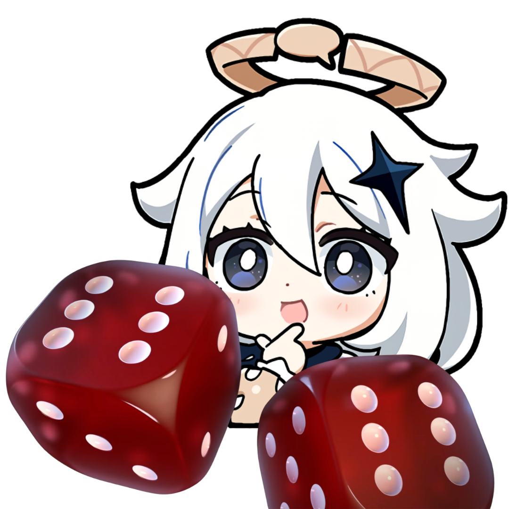

# Gacha Bravery

Gacha Bravery is a gacha game team and loadout randomizer inspired by Ultimate Bravery from League of Legends. Roll a team of characters with random weapons and artifact sets, using the characters and items in your collection.

## Features

* Randomly assign each character a compatible weapon and either a 4-piece artifact set or, optionally, two different 2-piece sets.
* Track which characters, weapons, and artifact sets you own. Selections are saved in your browser and used as the randomizer pools.
* Review previous rolls in the roll history.

Genshin Impact is currently the only available game; other games shown in the menu are not yet available.

See [CHANGELOG.md](CHANGELOG.md) for the release history.
